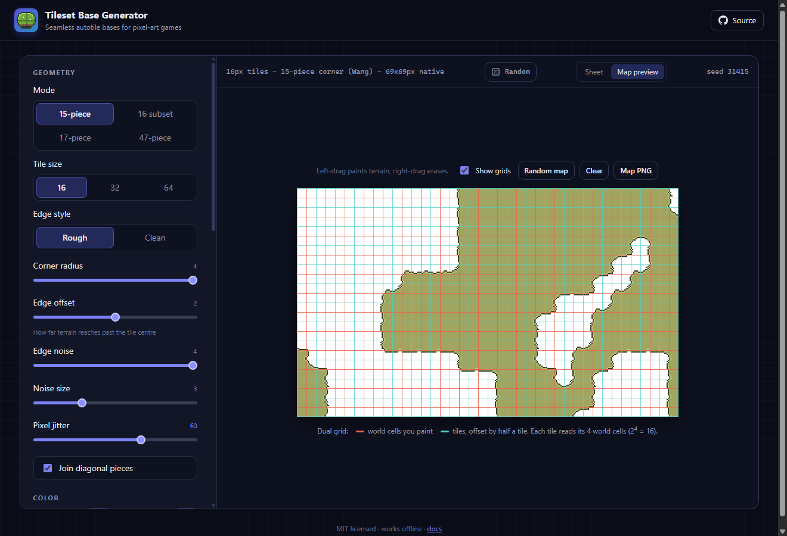
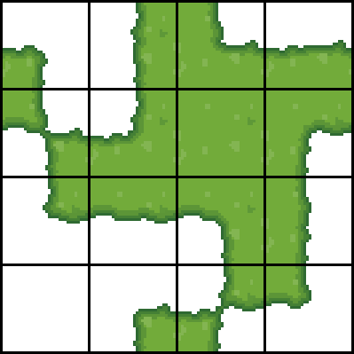
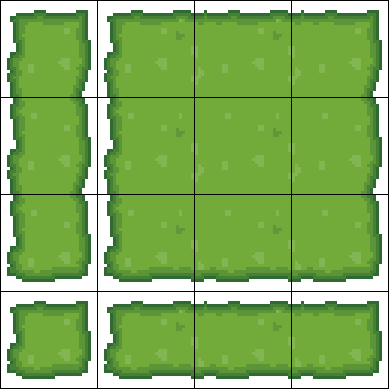
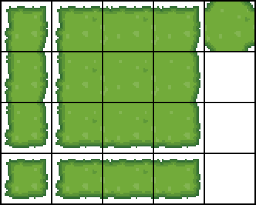
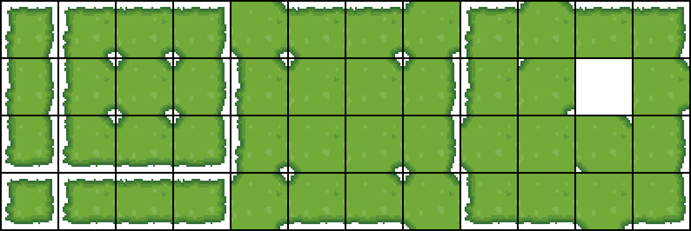
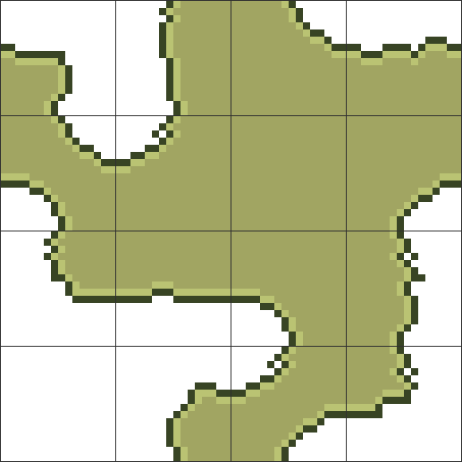
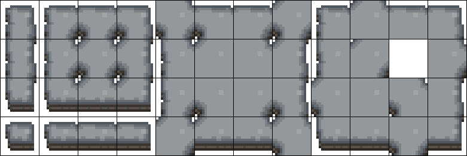

# Tileset Base Generator

A free, open-source generator for **seamless autotile tileset bases**. Choose a format and a tile size, adjust the shape and colours, and download a PNG sprite sheet plus JSON tile metadata.

- **Formats:** 15-piece (dual-grid / Wang corner), 16 subset, 17-piece (top-down), 47-piece (blob)
- **Tile sizes:** 16, 32 and 64 px
- Rough or clean edges, corner radius, padding, edge noise, pixel jitter, shading ramp, light rim, texture, flecks
- Optional **elevation edge** (a rock cliff face under south-facing edges)
- **Olive** preset with a flat fill, dark outline and light rim, the style common in dual-grid tutorials
- **Map preview:** paint terrain and watch the tiles autotile in real time, with the dual grid drawn on top
- PNG export (native, or exactly 1024 px with uniform grid lines) and JSON metadata
- No build step and no dependencies: open `index.html` and it runs offline

**Live app:** https://layfate.github.io/tileset-base-generator/



## Formats

| 15-piece (dual grid) | 16 subset | 17-piece top-down |
| :---: | :---: | :---: |
|  |  |  |



### 15-piece: dual grid / Wang 2-corner / marching squares



This is the tileset behind the **dual-grid system**:

- You paint terrain on a **world grid**.
- Tiles are drawn on a second grid **offset by half a tile**, so every tile sits where 4 world cells meet.
- Each tile is chosen from those 4 cells. That's 2⁴ = 16 combinations: 15 tiles plus an empty one, compared with 47 for an 8-neighbour blob set.

The 16 tiles are laid out so they also join into one continuous picture.

**Edge offset** sets how far terrain reaches past the tile centre. Hand-drawn dual-grid sets usually let terrain bulge a little past the halfway line. **Join diagonal pieces** connects the two diagonal tiles through the centre.

Corner bitmask: `TL = 1, TR = 2, BR = 4, BL = 8`. In the map preview, **Show grids** draws the world grid in red and the tile grid in teal.

### 16 subset

The 17-piece set without the cross tile, in a 4×4 sheet. It has a 3×3 block, a vertical and a horizontal strip, and a single island. That's enough for separate rectangular landmasses.

### 17-piece: top-down

A classic hand-drawn top-down set:

- a 3×3 block (9 tiles)
- a vertical strip (3) and a horizontal strip (3)
- a single island (1)
- a cross tile with four inner corners (1)

It covers rectangular landmasses of any size. It has no T-junction tiles, so the map preview falls back to the closest tile when you paint shapes the set can't represent.

### 47-piece: blob

Each tile is defined by its **8 neighbours**. A corner only counts when both sides next to it are also terrain, which reduces 256 combinations to 47 unique tiles. This is the complete set: any painted shape tiles correctly.

Edge bitmask (clockwise from north): `N = 1, NE = 2, E = 4, SE = 8, S = 16, SW = 32, W = 64, NW = 128`.

The sheet uses the common **12×4 layout**. The left 4×4 block holds the 16 tiles with no filled corners: strips, a single island, and a 3×3 block whose inner corners are all notched. The middle and right blocks hold the tiles with mixed corners. There's one empty slot at row 1, column 10.



## Using the web app

Open the [live app](https://layfate.github.io/tileset-base-generator/), or clone the repo and double-click `index.html`. No server is needed.

| Control | What it does |
| --- | --- |
| Mode / Tile size | Tileset format and tile size in pixels |
| Random | Rolls new style settings (shape, noise, shading, colours, extras) scaled to the current tile size. Mode, tile size and output settings stay as they are. Half the rolls use a preset palette; the rest invent one around a random hue. The header shows the roll number |
| Edge style | **Rough**: pixel-jittered edges. **Clean**: smooth wobble only |
| Corner radius | Rounds outer and inner corners |
| Tile padding | Gap between the terrain and an open tile edge (16 / 17 / 47) |
| Edge offset | 15-piece: how far terrain reaches past the tile centre |
| Edge noise / Noise size | Strength and feature size of the edge wobble |
| Pixel jitter | Rough style: how ragged the edge is at the single-pixel level |
| Base / Edge / Rock / Rim | Fill colour, outline colour, cliff colour, rim highlight colour |
| Light rim | A 1 px highlight just inside the outline |
| Presets | Grass, stone, dirt, water and sand set colours. **Olive** also switches on the light rim and a flat fill, with round, ragged edges |
| Elevation edge / Wall height | Draws a cliff face under south-facing edges |
| Shades / Edge fade | Number of colours from outline to fill, and how wide the fade is |
| Texture noise / Flecks | Interior variation and grass-style flecks |
| Join diagonal pieces | 15-piece only: the two diagonal tiles connect through the centre instead of touching at a single point |
| White bg / Black grid | Sheet background and grid lines |
| Grid line / Grid color | Line thickness and colour. Every line, including the outer frame, has the same thickness at any zoom and in every export |
| Margin | Even padding around the whole sheet |
| 1024 px | Exports with the long side exactly 1024 px. Tiles get the largest whole-number zoom that fits, the grid stays uniform, and the leftover space becomes equal padding |

Shortcuts: <kbd>D</kbd> rolls random settings, <kbd>R</kbd> picks a new seed, <kbd>Ctrl</kbd>+<kbd>S</kbd> downloads the PNG.
Settings are saved in your browser. URL parameters work too, for example `?mode=47&size=16&seed=7&preset=sand&elevation=1&tab=preview`. Add `&random=<roll>` to share a roll of the Random button.

## Command line

Requires Node.js 16 or newer. No `npm install` needed.

```bash
node cli.js --mode 47 --size 32 --out blob.png --json
node cli.js --mode 15 --size 16 --preset olive --scale 8
node cli.js --mode 15 --size 16 --preset sand --elevation --scale 4
node cli.js --mode 17 --size 32 --fit 1024 --grid-width 2 --margin 16
node cli.js --mode 47 --size 32 --random 4242   # same as roll #4242 in the app
node cli.js --help
```

`--json` also writes a metadata file containing each tile's position and bitmask. `--scale` and `--fit` enlarge the tiles by whole numbers only. Grid lines stay at `--grid-width` pixels.

## Importing into an engine

The JSON file lists every tile's `x`, `y`, `col`, `row` and `mask`, plus `margin` and `spacing` for the native-size PNG. Spacing is the grid line width (0 when the grid is off), and margin is the outer padding plus one line. For engine import, turn off **Black grid** and **White bg** so you get a clean, transparent sheet.

- **Godot 4:** create a TileSet atlas with the PNG. Use the terrain mode *Match Corners* for the 15-piece set and *Match Corners and Sides* for the 47-piece set, and set each tile's peering bits from `connects` in the JSON.
- **Tiled:** create a Terrain Set. Use *Corner* for 15-piece and *Mixed* for 47-piece.
- **Unity:** use a Rule Tile, with one rule per mask.
- **GameMaker:** the 47-piece mask order works with any standard blob autotile lookup.

## How it works

Every tile is rendered on an extended grid: the tile plus a margin on all sides.

1. Build a binary shape from the tile's connectivity mask, extending it into the margin.
2. Apply a morphological close and open (built on a Euclidean distance transform) to round the corners.
3. Build a signed distance field and offset it with value noise. The noise **repeats every tile width**, so any edge joins seamlessly with any compatible neighbour.
4. Remove stray single pixels, add the optional cliff face, then shade by distance to the edge.

`test/seams.test.js` checks every format, every tile size and several settings. It verifies that open edges stay empty and that connected edges line up across tiles:

```bash
npm test
```

## Project layout

```
index.html          web app
src/layouts.js      formats, bitmasks, sheet layouts
src/generator.js    tile renderer (shared by web + CLI)
src/presets.js      colour presets and defaults
src/preview.js      autotiled map preview
src/main.js         UI wiring
src/styles.css      UI styles
cli.js              Node CLI with a built-in PNG encoder
test/               seam tests
```

## Contributing

Issues and pull requests are welcome. Ideas: isometric 2:1 projection, more presets, Godot `.tres` / Tiled `.tsx` export, more sheet layouts.

## License

[MIT](LICENSE)
